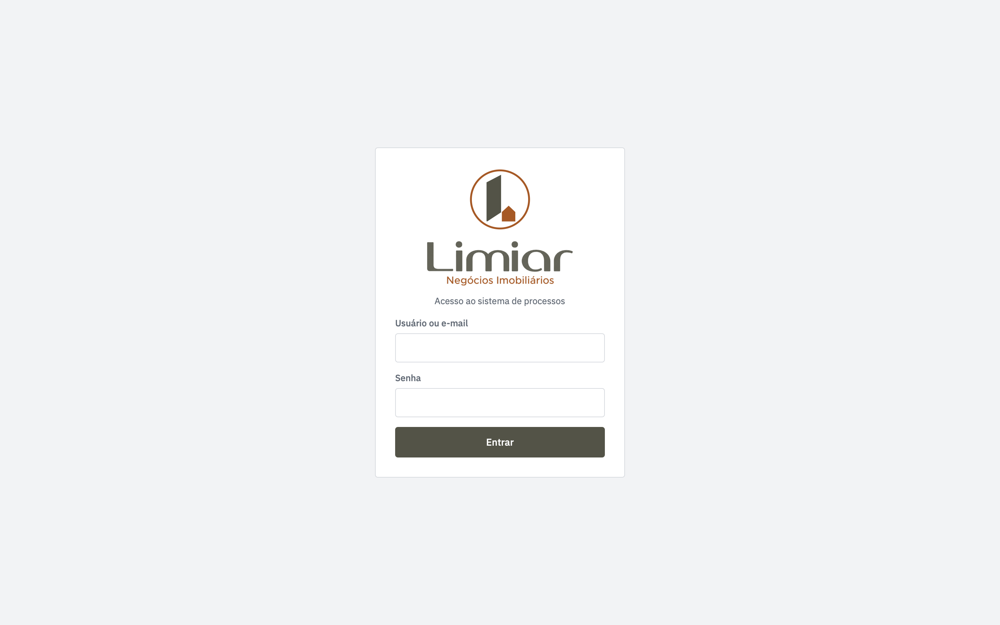

# Real Estate Process Tracker

Process checklist for **Limiar Imóveis**, a real estate agency. Every property deal goes through several steps and partners, and this system shows exactly where each one stands.

**Live:** [limiarimoveis.com.br](https://limiarimoveis.com.br)

## Features

- **Deal pipeline:** first contact → client registration → technical survey → lawyer → notary → property registry.
- **Editable templates:** the agency defines its own steps and checklists.
- **Partners:** technicians, lawyers and notary offices linked to each step.
- **Per step:** owner, deadline and file attachments.
- **Owner dashboard:** overview of all deals and what is late.
- Mobile first.

## Stack

- **Frontend:** React, Vite, TypeScript, React Router
- **Backend:** Node.js, Express, Multer (attachments), JWT auth
- **Database:** PostgreSQL
- **Infra:** Docker on a Linux VPS, Nginx, Let's Encrypt SSL, Cloudflare

---

**About the code:** this is a client project, so the source code is private. This repository documents what was built and how. I am happy to walk through the code and architecture in a call.

Built by [José Henrique Rodrigues](https://www.linkedin.com/in/josehenriquerodrigues-dev) · SmartHelp LTDA
